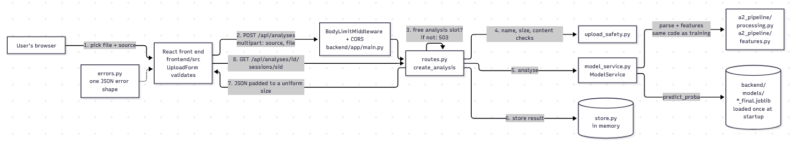

# LogSentry - Log Anomaly Detection

COS30049 Assignment 3 - Session 12, Group 3 - Shaan Panchal, Neeven Emmanuel Thumma, Dominique Tait

## 1. What LogSentry is

System logs are far too long to read line by line, and the one odd session that matters is easy to miss. LogSentry is for operators and security analysts who need to find it. You upload an HDFS or BGL log (LOGPAI, 2023), LogSentry gives every session an anomaly score, flags the risky ones, and lets you open any session to read its original log lines.

It is a React front end (Meta Platforms, n.d.) talking to a FastAPI back end (FastAPI, n.d.), which runs the scikit-learn model (Pedregosa et al., 2011) we trained in Assignment 2. For this assignment we treated that model as a black box and put our effort into the application around it, mainly into making it hard to abuse.

## 2. Repository layout

- `frontend/`: the React app, built with esbuild and served on port 5173.
- `backend/app/`: the FastAPI app, served on port 8000.
- `backend/a2_pipeline/`: the parts of the Assignment 2 pipeline the back end uses (parsing, features, cluster transform), unchanged, so prediction processes logs exactly as training did.
- `backend/models/`: the trained models.
- `backend/tests/`: the automated tests.
- `backend/manual_upload_tests/` and `backend/attacks/`: the scripts that attack a running back end (Sections 8 and 9).
- `sample_logs/`: the two sample logs used below.

## 3. Setup and run

Run every command from the repository root unless a step says otherwise. You need two terminals: one for the back end and one for the front end.

### Requirements

- Python **3.12 or 3.14**
- Node.js **24** (the exact version is in `frontend/.nvmrc`: 24.21.0)

### Back end (Terminal 1)

Check the Python version first with `python --version` (Windows) or `python3 --version` (Mac/Linux). It must say 3.12 or 3.14, the versions the pinned packages and saved models have been tested on. If your default Python is a different version, use `py -3.12` on Windows or `python3.12` on Mac/Linux in place of `python` or `python3` in the second command below.

Windows:
```
cd backend
python -m venv .venv
.venv\Scripts\pip install -r requirements.txt
.venv\Scripts\python -m uvicorn app.main:app --host 127.0.0.1 --port 8000
```

Mac/Linux:
```
cd backend
python3 -m venv .venv
.venv/bin/pip install -r requirements.txt
.venv/bin/python -m uvicorn app.main:app --host 127.0.0.1 --port 8000
```

Wait for `Application startup complete`. The models load at this point, once, not on every request. The API documentation is then at http://127.0.0.1:8000/docs.

### Front end (Terminal 2)

```
cd frontend
npm ci
npm start
```

`npm ci` may print an `install-scripts` warning about `esbuild@0.28.2`. It is safe to ignore: esbuild's platform binary is installed as a separate package, and the app builds and runs without that script.

Open **http://localhost:5173**, choose source **HDFS** and upload `sample_logs/sample_HDFS.log`. Within a few seconds you should see the summary (200 sessions, 40 flagged), the score histogram, the session timeline and the session table. Click any session to see its log lines.

> **Use `localhost`, not `127.0.0.1`, for the front end.** The back end's CORS setting allows only `http://localhost:5173`. If you open `http://127.0.0.1:5173`, the browser blocks every request to the API.

If something doesn't start:
- Check that the back end is still running in Terminal 1 and printed `Application startup complete`.
- Check that nothing else is using port 8000 or 5173.
- Make sure you ran `npm ci` inside `frontend/`, not in the repository root.

Stop either server with **Ctrl+C** in its terminal.

### Running the tests

Back end, Windows:
```
cd backend
.venv\Scripts\pip install -r requirements-dev.txt
.venv\Scripts\python -m pytest
```

Back end, Mac/Linux:
```
cd backend
.venv/bin/pip install -r requirements-dev.txt
.venv/bin/python -m pytest
```

Front end:
```
cd frontend
npm test
```

To check the security defences next, see Sections 8 and 9. Each one has a script to run against the running back end.

### Settings

All settings are optional environment variables, read in `backend/app/config.py`. The app has no passwords, API keys or other secrets.

- `LOGSENTRY_FRONTEND_ORIGIN` (default `http://localhost:5173`): the only origin CORS allows.
- `LOGSENTRY_MAX_UPLOAD_BYTES` (default 5242880, which is 5 MiB): the largest log file accepted.
- `LOGSENTRY_MAX_CONCURRENT_ANALYSES` (default 2): how many analyses can run at once. Any more get an immediate 503.
- `LOGSENTRY_UNIFORM_SIZE` (default 1, on): pads responses so their size doesn't reveal the result. Set it to 0 only to measure the attack in Section 9.

### Turning a defence off and on

Every defence is **on by default**. Two of them can be switched off so you can measure the attack in Sections 8.2 and 9. The upload checks in Section 8.1 cannot be switched off.

| Defence | Section | Variable to turn it off |
|---|---|---|
| Concurrency cap (DoS) | 8.2 | `LOGSENTRY_MAX_CONCURRENT_ANALYSES=1000` |
| Response padding (size side channel) | 9 | `LOGSENTRY_UNIFORM_SIZE=0` |

The variable only affects a back end started in the same terminal after you set it. Stop the back end with **Ctrl+C** first, then run these in the `backend` folder.

**Turn a defence off**, then start the back end:

| Terminal | Command (DoS example; swap in the other variable for Section 9) |
|---|---|
| PowerShell | `$env:LOGSENTRY_MAX_CONCURRENT_ANALYSES=1000` |
| Command Prompt (cmd) | `set LOGSENTRY_MAX_CONCURRENT_ANALYSES=1000` |
| Mac/Linux | `export LOGSENTRY_MAX_CONCURRENT_ANALYSES=1000` |

```
.venv\Scripts\python -m uvicorn app.main:app --host 127.0.0.1 --port 8000      (Windows)
.venv/bin/python -m uvicorn app.main:app --host 127.0.0.1 --port 8000          (Mac/Linux)
```

**Turn it back on**: stop the back end with Ctrl+C, clear the variable, then start the back end again with the same command:

| Terminal | Command |
|---|---|
| PowerShell | `Remove-Item Env:LOGSENTRY_MAX_CONCURRENT_ANALYSES` |
| Command Prompt (cmd) | `set LOGSENTRY_MAX_CONCURRENT_ANALYSES=` |
| Mac/Linux | `unset LOGSENTRY_MAX_CONCURRENT_ANALYSES` |

Closing the terminal also clears the variable, so a new terminal always starts with every defence on.

## 4. Pinned dependencies

Back end (`backend/requirements.txt`, Python 3.12 or 3.14): fastapi 0.143.0, starlette 1.7.0, pydantic 2.14.1, uvicorn 0.46.0, python-multipart 0.0.31, numpy 2.5.3, pandas 3.0.6, scikit-learn 1.9.1, scipy 1.18.1, joblib 1.6.0.

The tests also need pytest 8.4.2 and httpx 0.28.1 (`backend/requirements-dev.txt`). scikit-learn must stay at 1.9.1, because the saved models are pickles created with that version.

Front end (`frontend/package.json`, Node.js 24.21.0): react 19.3.0, react-dom 19.3.0, esbuild 0.28.2. `npm ci` installs the exact versions recorded in `frontend/package-lock.json`.

## 5. Architecture



One request, step by step:

1. **The user picks a file and a source (HDFS or BGL).** The upload form checks the file type and size before sending anything. This is for usability only. The back end does the real checks.
2. **The front end sends `POST /api/analyses`** as multipart form data (`source`, `file`). `BodyLimitMiddleware` refuses a request that is too large before reading it, and CORS lets only our own front end read the reply (`backend/app/main.py`).
3. **`create_analysis` in `routes.py` asks for one of the analysis slots.** If every slot is busy it answers 503 straight away, instead of queueing work it cannot handle.
4. **`upload_safety.py` checks the upload.** It checks the file name, saves the file under a name the server generates, enforces the size limit while copying, and checks that the content really is a text log in the chosen format.
5. **`model_service.py` analyses the log.** It parses the log and builds session features with the same A2 code used in training (`backend/a2_pipeline/processing.py`, `features.py`), then scores every session with the model loaded at startup. The uploaded file is then deleted.
6. **The result is stored in memory** (`store.py`) under a random ID.
7. **The back end returns JSON** with the summary and every session's anomaly score. The response is padded so its size doesn't reveal how many sessions were flagged.
8. **When the user selects a session**, the front end calls `GET /api/analyses/{id}/sessions/{session_id}` and shows that session's details and log lines.

Every error, expected or not, comes back in the same shape, `{"error": "...", "detail": "..."}` (`backend/app/errors.py`). Unexpected errors are written to the server log, and the user never sees a stack trace.

The API has four endpoints, all documented with examples at http://127.0.0.1:8000/docs:

- `POST /api/analyses`: upload a log (`source` and `file`). Returns the summary and every scored session.
- `GET /api/analyses/{id}`: get a stored analysis again.
- `GET /api/analyses/{id}/sessions/{session_id}`: get one session in detail, including its log lines.
- `DELETE /api/analyses/{id}`: delete a stored analysis.

## 6. Threat model

A log analyser is an unusual target, because the people whose activity is in the logs are the very people it is meant to catch. That shaped everything below.

**Who would attack it?**
- An intruder on a monitored system who wants their activity to slip past unnoticed.
- Anyone who can reach the API directly. It is an HTTP service, so nobody has to go through our front end.

**What do they want?**
- To get their malicious session scored as normal, hidden among normal logs.
- To plant content in a log line, such as HTML or a script inside a message, and have it run in the analyst's browser.
- To knock the service over, so logs stop being checked at all.
- To find out whether their log was flagged, even without being able to read the result.

**What can they actually do?**
- Upload any file they like, with any name, size or content, using a tool such as curl. That skips the front end's checks completely.
- Send many requests at once, or one log that is deliberately expensive to process.
- Time the responses or measure how big they are.

**Which Section 2.7 risks this design has** (with reference to OWASP Foundation, 2021)

Risks that apply:
- **Unsafe file upload:** the whole app is built around uploading log files.
- **Denial of service:** parsing and scoring a log costs far more than sending one.
- **Missing rate limiting:** every API can be flooded.
- **Misconfiguration and vulnerable dependencies:** every app depends on libraries and default settings.
- **Unsafe model loading:** the models are joblib pickles. They ship in the repository rather than being downloaded, which lowers the risk.

Risks that don't apply:
- **SQL injection:** there is no database. Results are kept in memory (`backend/app/store.py`).
- **Command injection:** the back end never runs a system command.
- **SSRF:** the back end never makes an outbound request based on the input.
- **Broken access control:** there are no user accounts. Analyses are reached through random UUIDs that can't be guessed.

We defended the two risks a log-upload service is most exposed to: unsafe file upload and denial of service (Section 8). The other risks that apply are real, and we have not built defences for them (Section 10). For Section 2.8 we chose the response-size side channel, because "was my log flagged?" is exactly what an intruder wants to know.

## 7. How malicious input is handled

- **Log text is never rendered as HTML.** React escapes all text, and the front end never uses `dangerouslySetInnerHTML`, so a `<script>` inside a log line is shown as plain text in the session detail view (`frontend/src/SessionDetail.jsx`). `backend/manual_upload_tests/fixtures/xss_demo.log` is a valid log with `` in its first line, for showing this.
- **Upload size is limited on the back end**, both for the whole request (`BodyLimitMiddleware` in `backend/app/main.py`) and for the file while it is saved (`save_upload` in `backend/app/upload_safety.py`).
- **CORS allows only `http://localhost:5173`** (`backend/app/main.py`), never every origin.
- **No secrets are in the repository.**
- **Why 5 MiB:** the sample logs are about 0.4 MB, and a real log extract of a few thousand sessions fits under 5 MiB. Larger files would make an analysis take long enough to tie up the server. The limit can be changed with `LOGSENTRY_MAX_UPLOAD_BYTES`.

## 8. Security defences to be marked (Section 2.7)

### 8.1 Unsafe file upload (Intermediate)

**The attack:** an attacker skips our front end and uses curl to send a file with a name like `../evil.log` (to write outside the upload folder), a file far larger than any real log, or a non-log file such as an executable or image renamed to `.log`.

**How the code stops it** (`backend/app/upload_safety.py`, called from `create_analysis` in `backend/app/routes.py`):
1. **File name:** a name containing a path, `..`, a drive letter, control characters or unusual symbols is refused with 400. Only `.log` and `.txt` are accepted. The name is only checked, never used: the file is saved under a name the server generates, in a private temporary folder.
2. **Size:** the file is copied in chunks and refused with 413 as soon as it passes 5 MiB. Separately, `BodyLimitMiddleware` refuses an oversized request before reading it, even when the request lies about its size.
3. **Content:** the extension and `Content-Type` header are not trusted. The bytes are checked for known binary signatures (PNG, ZIP, PDF, executables and others), NUL and control characters, and valid UTF-8. At least 90% of lines must match the chosen source's log format.

**Proof:** with the back end running, this sends 30 test cases to it, most of them attacks: path names such as `../evil.log`, a file one byte over the limit, a request over the limit, PNG bytes renamed `.log`, a log sent with the wrong source, and filenames with shell or control characters. It prints a PASS/FAIL table and ends with `30 passed, 0 failed`. Appendix A explains the output.

```
backend\.venv\Scripts\python backend\manual_upload_tests\run_upload_tests.py      (Windows)
backend/.venv/bin/python backend/manual_upload_tests/run_upload_tests.py          (Mac/Linux)
```

A single attack can also be sent by hand (on Windows PowerShell, type `curl.exe`, because `curl` there is a different command):

```
curl -F source=HDFS -F "file=@sample_logs/sample_HDFS.log;filename=../evil.log" http://127.0.0.1:8000/api/analyses
```

It is refused with `{"error":"bad_request","detail":"The file name must be a plain file name, not a path."}`.

**Cost:** a genuine log with many lines in an unexpected format is refused (422) rather than analysed, and filenames with unusual characters must be renamed before upload.

### 8.2 Denial of service (Advanced)

**The attack:** analysing a log costs far more than sending it. An attacker sends many large logs at once, so the server spends all its time on them and real users wait or time out.

**How the code stops it** (`backend/app/routes.py`, `backend/app/config.py`): `create_analysis` is a plain `def` endpoint, so FastAPI runs scoring in a worker thread and it doesn't block other requests. At most `LOGSENTRY_MAX_CONCURRENT_ANALYSES` analyses (default 2) run at once. Any extra upload is refused immediately with **503** and `Retry-After: 5`, instead of queueing and holding a thread and its upload.

**Proof:** `backend/attacks/dos_demo.py` sends 12 log files of 4.84 MB at the same time, just under the upload limit, while timing ordinary GET requests. Results from 25 October 2026 on a Windows laptop with one uvicorn worker:

- **Without the defence** (`LOGSENTRY_MAX_CONCURRENT_ANALYSES=1000`): all 12 uploads accepted (201). The flood took 9.6 s, and GET requests slowed to a median of 150 ms and a maximum of 1402 ms.
- **With the defence** (cap of 2): 2 accepted (201) and 10 refused (503). The flood took 1.6 s, and GET requests stayed at a median of 26 ms and a maximum of 432 ms.

To run it:
1. Turn the defence **off** (`LOGSENTRY_MAX_CONCURRENT_ANALYSES=1000`) and start the back end. The exact commands for each terminal are in "Turning a defence off and on" in Section 3.
2. Run the script below.
3. Turn the defence back **on** and restart the back end.
4. Run the script again.

The script, from the repository root:
```
backend\.venv\Scripts\python backend\attacks\dos_demo.py --flood 12      (Windows)
backend/.venv/bin/python backend/attacks/dos_demo.py --flood 12          (Mac/Linux)
```

**Cost:** when more than two analyses are already running, real users also get a 503 and have to retry a few seconds later.

## 9. Advanced security to be marked (Section 2.8): response-size side channel

**The attack:** HTTPS hides what a response says, but not how long it is, so the size of encrypted traffic can leak what a web application decided (Chen et al., 2010). Before our fix, the analysis response for a log with a flagged session was a few bytes different in size from one with no flagged sessions. Someone who could only see the size of the traffic could therefore tell whether a log had been flagged. `backend/attacks/size_attack.py` sends two logs 100 times each: one with only normal sessions, and one where a single normal session is swapped for a flagged one with the same number of lines. It fits a size threshold on the first half of the runs and tests it on the second half, so 50% accuracy means guessing.

**How the code stops it** (`_padded`, `_analysis_response` and `_detail_response` in `backend/app/routes.py`): JSON ignores trailing spaces, so each response is padded with spaces to a fixed size. An analysis is padded to `2048 + 256 × number of sessions` bytes, so its size reveals only the session count, which the sender already knows. A session detail is padded to the size it would have with the widest possible score and the longest cluster description. `backend/tests/test_size.py` flips the decision on the same session and checks that the size stays the same.

**Before and after** (`backend/attacks/size_results.json`):

- **Before** (`LOGSENTRY_UNIFORM_SIZE=0`): a normal log's response was 3362 bytes and a flagged log's was 3356 bytes. The attack was right 100% of the time.
- **After** (default): both were 7168 bytes. The attack was right 50% of the time, which is guessing.

To run it, turn the defence **off** (`LOGSENTRY_UNIFORM_SIZE=0`) and start the back end. The exact commands for each terminal are in "Turning a defence off and on" in Section 3. Then, from the repository root:
```
backend\.venv\Scripts\python backend\attacks\size_attack.py --label before      (Windows)
backend/.venv/bin/python backend/attacks/size_attack.py --label before          (Mac/Linux)
```
Turn the defence back **on**, restart the back end, and run it again with `--label after`. Each run adds its result to `size_results.json`.

**Cost:** analysis responses are about twice as large (7168 instead of 3362 bytes here), and session details carry up to about 2 KB of padding. Compression (gzip) must stay off, because compressed sizes would differ again.

**Why not a timing side channel:** we tried that first, since response time can also reveal a web application's decision (Bortz and Boneh, 2007). The back end runs the cluster model only for flagged sessions, but that costs about 0.35 ms, while normal network jitter was 14 to 32 ms. Across 5 runs of 200 requests per outcome the attack's accuracy ranged from 49% to 77%, so we could not show a reliable leak. The response size leaked on every request, so that is the one we defended and measured.

## 10. Known limitations and next steps

- Results are kept in memory only. They are lost when the server restarts, and there is no limit yet on how many analyses are kept, so memory grows until a restart.
- There are no user accounts, so anyone who has an analysis ID can read or delete that analysis.
- Only HDFS and BGL logs are supported.
- When the server is busy, the concurrency cap also turns real users away with a 503. They have to wait a few seconds and retry.
- Python's multipart parser removes Windows-style paths such as `C:\Windows\evil.log` before our code sees them, so these names arrive as `evil.log` and are accepted. This is harmless, because the name is never used as a path. Details are in Appendix A.
- We have no defence of our own against request-rate abuse, vulnerable dependencies or a tampered model file. The concurrency cap limits how much work runs at once, but it does not limit how often one client can send requests. The models are not checked against a hash when the server starts.

Next, we would:
- add a database for saved results, with a limit on how long they are kept;
- add user accounts so each analysis belongs to its owner;
- add rate limiting per client;
- check the model files against a known hash at startup;
- scan dependencies with `pip-audit` and `npm audit` as part of every build.

## 11. References

Bortz, A. and Boneh, D. (2007) 'Exposing private information by timing web applications', in *Proceedings of the 16th International Conference on World Wide Web*. ACM, pp. 621–628. Available at: https://crypto.stanford.edu/~dabo/abstracts/webtiming.html (Accessed: 28 October 2026).

Chen, S., Wang, R., Wang, X. and Zhang, K. (2010) 'Side-channel leaks in web applications: a reality today, a challenge tomorrow', in *2010 IEEE Symposium on Security and Privacy*. IEEE, pp. 191–206. Available at: https://www.microsoft.com/en-us/research/?p=158925 (Accessed: 28 October 2026).

FastAPI (n.d.) *FastAPI documentation*. Available at: https://fastapi.tiangolo.com/ (Accessed: 28 October 2026).

LOGPAI (2023) *Loghub: a large collection of system log datasets for AI-driven log analytics* [Dataset]. Zenodo. Available at: https://doi.org/10.5281/zenodo.8196385 (Accessed: 28 October 2026).

Meta Platforms (n.d.) *React documentation*. Available at: https://react.dev/ (Accessed: 28 October 2026).

OWASP Foundation (2021) *OWASP Top 10: 2021*. Available at: https://owasp.org/www-project-top-ten/ (Accessed: 28 October 2026).

Pedregosa, F., Varoquaux, G., Gramfort, A., Michel, V., Thirion, B., Grisel, O., Blondel, M., Prettenhofer, P., Weiss, R., Dubourg, V., Vanderplas, J., Passos, A., Cournapeau, D., Brucher, M., Perrot, M. and Duchesnay, É. (2011) 'Scikit-learn: machine learning in Python', *Journal of Machine Learning Research*, 12, pp. 2825–2830.

## 12. Generative AI statement

We used generative AI tools during this assignment. Every member read, ran and tested the work they submitted, and each of us can explain the parts we present in the video.

**Neeven Emmanuel Thumma:**  : Generative AI tools (claude), were used for debugging assistance during testing, helping identify and resolve command-related errors, and for minor grammar and wording corrections to improve the clarity of the written content. All implementation, analysis, and final decisions were completed independently by the author. AI was not used to generate the assignment’s solutions or core content.

**Dominique Tait:** I used Claude to learn the general rules and conventions for creating architecture diagrams. I then created the diagram myself using the Mermaid Live Editor ([https://mermaid.live](https://mermaid.live)), without using its AI features. I checked every box and arrow against the code to ensure that each step accurately represents what `routes.py`, `upload_safety.py` and `model_service.py` actually do, in the correct order.

**Shaan Panchal:** OpenAI tools (ChatGPT) were used for research purposes to explore relevant concepts and gather general background information related to the assignment. All research was independently reviewed and evaluated by the author. No AI-generated content, solutions, or assignment work were used in the final submission.

## Appendix A. Reading the upload test kit's output

`backend/manual_upload_tests/run_upload_tests.py` is a local test utility, not application code. It uses only the Python standard library, never starts or stops the server, and deletes its own temporary files and the analyses it created when it finishes. Its small test files are in `backend/manual_upload_tests/fixtures/`; the oversized files are generated at run time, not stored.

Each row of its table shows the test, the expected and actual HTTP status, and the result:

- **PASS:** the status matched, and a refusal had the expected error code and reason, so the file was refused for the right reason.
- **FAIL:** the server answered, but not as expected. The line below the row shows what it said instead.
- **ERROR:** no reply, for example because the server is down. This is never counted as a pass.

It exits with 0 if every case passed, 1 if any failed, and 2 if the server could not be reached. Useful options: `--source BGL` runs the filename and size cases with a BGL log, `--verbose` also shows the server's reply for passing cases, and `--dry-run` lists the cases without sending anything.

**Known limitation: Windows drive and UNC names.** python-multipart 0.0.31 changes some filenames before FastAPI or our code see them. For a name starting with a drive (`C:\`) or `\\`, it keeps only the text after the last backslash, an old Internet Explorer 6 workaround. So `C:\Windows\evil.log` arrives as `evil.log` and is accepted (201), and the table marks these cases "known limitation". They are still harmless: the path was removed before our code ran, the file is saved under a server-generated name, and no path is ever built from the filename. When `check_filename` is called directly, it refuses these names with 400 (`test_filename_check_unit_cases` in `backend/tests/test_upload_defence.py`).
