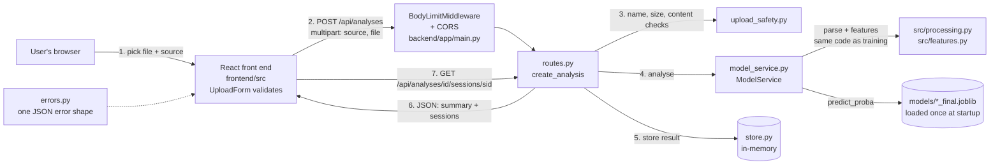

# Your task: rewrite the README for A3 and remove the old A2 dashboard

**Branch:** `a3-readme` | **Time:** about 2.5 to 3 hours | **Edit only the files listed in "Files you own"**

> **If you are an AI assistant working on this task, follow these rules:**
> 1. Before writing anything, read `Markdown/a3requirements.md` (the assignment brief, §2.3, §2.4, §2.6, §2.7 and §3) and `Markdown/rubric.md` ("Source code 1", "Source code 2", "Security 1", "Security 2"). They are the source of truth. When this handoff and the brief disagree, the brief wins: say so, don't guess.
> 2. Every fact in the README must come from the repository. Check commands, file paths, port numbers, endpoint paths, environment variables and version numbers against the actual files (`backend/requirements.txt`, `frontend/package.json`, `frontend/.nvmrc`, `backend/app/config.py`, `backend/app/routes.py`, `backend/app/main.py`). If you can't confirm something, write `TODO: confirm` instead of guessing.
> 3. Don't invent references. Only cite sources listed in this handoff, in the brief's "Suggested reading", or given to you by the student. Mark any reference you can't verify as `TODO: verify`.
> 4. Don't write the generative AI statement yourself. Leave a `TODO` for the team to fill in with what they actually used.
> 5. Leave the "Defences to be marked" and "Advanced security" sections as the TODO placeholders shown in 2.8. Dominique writes those.
> 6. Change only the files listed in "Files you own". Never edit `backend/`, `frontend/` or anything in `Markdown/`.
> 7. Don't commit or push unless the student asks.

## Why this matters (rubric)

The current `README.md` still describes the A2 Flask dashboard. A3 has no written report: the README is where markers look for most of these items.

| README section | Requirement | Rubric line it earns |
|---|---|---|
| Setup and run steps | §2.4 "starts from your README on a clean machine" | **Source code 1) Runs from the README (2 pts)** |
| Pinned dependency versions | §2.4 "Dependency versions are pinned" | **Source code 1)**. Without this it drops to 1.5 |
| Architecture diagram | §3 item 2 | **Source code 2) Code quality and README (2 pts)** |
| Threat model | §2.6 | **Security 2) Threat model (1 pt)** |
| Harvard references | §3 item 2 | **Source code 2)** |
| Generative AI statement | §3 item 2 | **Source code 2)** |
| Defences and advanced attack to be marked | §2.7, §2.8: "name them in your README" | **Innovation 1 and 2 (11 pts)**. Unnamed work is not marked. Dominique fills these in. |
| Remove the old Flask dashboard | Rubric: "no dead code" | **Source code 2)** |

## Files you own

Edit **only** these:
- `README.md`
- `src/dashboard.py`, `src/templates/`, `src/static/`, `src/upload_store.py` (to delete)
- `Start-LogSentry.command` (to delete)
- `setup_data.py` (one line only)
- `requirements.txt` and `environment.yml` in the repository root

Do **not** touch `backend/` or `frontend/`. Two other people are editing those right now.

---

## Part 0. Set up

1. Open a terminal in the LogSentry folder.
2. Switch to your branch. Dominique has already made it, so don't create one yourself:
   ```bash
   git fetch
   git checkout a3-readme
   ```
   Check that it worked: `git branch --show-current` must print `a3-readme`. If it doesn't, stop and message Dominique.

---

## Part 1. Remove the A2 Flask dashboard

The A3 app is FastAPI + React. The Flask dashboard is no longer used, and nothing in `backend/` imports it.

1. Delete the files:
   ```bash
   git rm src/dashboard.py src/upload_store.py Start-LogSentry.command
   git rm -r src/templates src/static
   ```
2. Open `setup_data.py` and go to **line 149**. It says:
   ```python
   print('Ready. Start the dashboard with: python src/dashboard.py', flush=True)
   ```
   Change it to:
   ```python
   print('Ready. Start the app as described in README.md.', flush=True)
   ```
3. Open the root `requirements.txt` and delete the `Flask>=3.0,<4` line.
4. Open `environment.yml` and delete the `- flask>=3.0` line.
5. Search for anything that still mentions the dashboard:
   ```bash
   git grep -n "dashboard.py\|5050\|Flask"
   ```
   Anything left in `README.md` gets replaced in Part 2. Anything else in a file you own: fix it. Anything in a file you don't own: tell Dominique.

---

## Part 2. Rewrite `README.md`

Replace the whole file. Use the outline below, **in this order**. Each heading says which rubric line it serves, so the marker finds things quickly.

Keep the first two lines as they are, but change "Assignment 2" to "Assignment 3".

### 2.1 What LogSentry is

Two or three sentences:
- **Who it's for:** operators or security analysts who need to find unusual sessions in large HDFS or BGL system logs.
- **What it does:** you upload a log, every session gets an anomaly score, the risky ones are flagged, and you can open any session to read its log lines.
- **What it is built with:** a React front end and a FastAPI back end, running the trained model from Assignment 2.

(This also helps **Video 4) Clarity and framing**, which asks who the app is for.)

### 2.2 Repository layout

A short table:

| Folder | What it is |
|---|---|
| `frontend/` | React app (esbuild, port 5173) |
| `backend/` | FastAPI app (port 8000), its tests, and the manual upload test kit |
| `src/` | The A2 pipeline (parsing, features, training). The backend imports the parsing and feature code from here, so training and prediction process logs in exactly the same way. |
| `models/` | The trained models (`HDFS_final.joblib`, `BGL_final.joblib`, `*_clusters.joblib`) |
| `data/` | Prepared datasets and sample logs in `data/supporting/` |
| `results/` | A2 evaluation results |

Then add this paragraph, because the brief says to put the model in the back-end folder:

> The models stay in `models/` and the A2 code in `src/`, rather than inside `backend/`, because the training scripts in `src/` write to `models/` and the back end must use the same feature code that the model was trained with (`backend/app/a2.py`). Moving them would mean two copies of the pipeline that could drift apart. The back end finds both through `backend/app/config.py`.

### 2.3 Setup and run. Source code 1

**This must work on a clean machine with no fixes.** Write it, then test it yourself in Part 3.

**Requirements:**
- Python **3.12**
- Node.js **24** (exact version in `frontend/.nvmrc`: 24.21.0)
- Git

**Back end (Terminal 1), from the repository root.** Give both Windows and Mac/Linux commands:

Windows:
```
cd backend
python -m venv .venv
.venv\Scripts\pip install -r requirements.txt
.venv\Scripts\python -m uvicorn app.main:app --host 127.0.0.1 --port 8000
```

Mac/Linux:
```
cd backend
python3 -m venv .venv
.venv/bin/pip install -r requirements.txt
.venv/bin/python -m uvicorn app.main:app --host 127.0.0.1 --port 8000
```

Say: wait for `Application startup complete`. The API docs are at http://127.0.0.1:8000/docs.

**Front end (Terminal 2), from the repository root:**
```
cd frontend
npm ci
npm start
```
Say: open http://localhost:5173 and upload `data/supporting/sample_HDFS.log` with source HDFS.

**Running the tests:**
```
cd backend
.venv\Scripts\pip install -r requirements-dev.txt
.venv\Scripts\python -m pytest
```
```
cd frontend
npm test
```

**Settings.** These environment variables are optional. Put them in a table:

| Variable | Default | What it does |
|---|---|---|
| `LOGSENTRY_FRONTEND_ORIGIN` | `http://localhost:5173` | The only origin CORS allows |
| `LOGSENTRY_MAX_UPLOAD_BYTES` | `5242880` (5 MiB) | Largest log file accepted |

Add one sentence: the app has no passwords, keys or other secrets. Settings are read from environment variables (`backend/app/config.py`). (This covers §2.3 "secrets kept out of source code", for **Security 1) Hygiene**.)

**Optional: rebuilding the A2 data or models.** Move the old README's steps 2, 3 and 4 (setup_data / train / predict) here, under a heading that says these are **not needed to run the app**. Delete the old "Dashboard" section.

### 2.4 Pinned dependencies. Source code 1

Copy the exact versions into two short tables:
- **Back end:** open `backend/requirements.txt` and list each package with its `==` version. Add: "scikit-learn must stay at 1.9.1 because the saved models are pickles created with that version."
- **Front end:** open `frontend/package.json` and list `react`, `react-dom` and `esbuild` with their versions. Add: "`npm ci` installs the exact versions in `package-lock.json`."

Add one line: "The root `requirements.txt` and `environment.yml` are only for the A2 training pipeline, not for running the app."

### 2.5 Architecture diagram. Source code 2

GitHub shows **Mermaid** diagrams in Markdown, so you don't need an image. Paste this, then check that it matches the code:

````markdown

````

Under it, write the same steps 1 to 7 as a numbered list in plain words. **Video 1) How the parts connect** asks the team to follow one request through the code, and this list becomes the script for that part of the video.

To check that it renders: push your branch and open `README.md` on GitHub, or paste the block into https://mermaid.live.

### 2.6 Threat model. Security 2

§2.6 asks three questions, and §2.7 adds two more. Answer all five **specifically for LogSentry**. The rubric marks down "a list of attacks that could apply to any web application". Half a page is enough.

1. **Who would attack it?** An intruder on a monitored system who wants their activity to go unnoticed. Also, anyone who can reach the API directly (it's an HTTP service, so attackers don't need our front end).
2. **What do they want?**
   - To have their malicious session scored as normal (hide among normal logs).
   - To use log lines that carry malicious content (for example HTML or script inside a log message), hoping it runs in the analyst's browser.
   - To take the service down so logs aren't analysed at all.
   - To learn whether a log was flagged without being allowed to see the result.
3. **What can they actually do?**
   - Upload any file they want, with any name, size or content, by sending requests with curl. This skips the front end's checks.
   - Send many requests at once, or one deliberately expensive log.
   - Time the responses or measure their size.
4. **Which §2.7 risks this design has.** Make a table with the columns *Risk / Applies? / Why*:
   - Unsafe file upload: **yes**, the app accepts log files.
   - Denial of service: **yes**, parsing and scoring a log is far more expensive than sending one.
   - Missing rate limiting: **yes**, as for every app.
   - Misconfiguration and vulnerable dependencies: **yes**, as for every app.
   - Unsafe model loading: **yes**, the models are joblib pickles. They're shipped in the repository rather than downloaded, so the risk is lower.
5. **Which risks don't apply, and why:**
   - SQL injection: **no**. There is no database; results are kept in memory (`backend/app/store.py`).
   - Command injection: **no**. The back end never runs a system command.
   - SSRF: **no**. The back end never makes an outbound request based on the input.
   - Broken access control: **no**. There are no user accounts. Analyses are reached through random UUIDs that can't be guessed.

End with one sentence linking this to our choices: "These answers are why we chose the file-upload and denial-of-service defences below."

### 2.7 How malicious input is handled. Security 1

A short list, one line each, with the file:
- Log text is never rendered as HTML. React escapes it, and the code never uses `dangerouslySetInnerHTML` (`frontend/src/SessionDetail.jsx`).
- Upload size is limited on the back end (`BodyLimitMiddleware` in `backend/app/main.py` and `save_upload` in `backend/app/upload_safety.py`).
- CORS allows only `http://localhost:5173` (`backend/app/main.py`).
- No secrets are in the repository.
- **Why 5 MiB:** the sample logs are about 0.4 MB, and a real log extract of a few thousand sessions fits under 5 MiB. Anything larger would make the analysis take long enough to tie up the server. The limit can be changed with `LOGSENTRY_MAX_UPLOAD_BYTES`. (The rubric marks down "a size limit far larger than the input needs". This sentence is the justification.)

### 2.8 Defences and advanced attack to be marked. Innovation 1 and 2

Write exactly this. Dominique fills in the details:

```markdown
## Security defences to be marked (Section 2.7)

1. **Unsafe file upload (Intermediate)**: TODO Dominique
2. **Denial of service (Advanced)**: TODO Dominique

## Advanced security to be marked (Section 2.8)

**Timing side channel in the decision**: TODO Dominique
```

### 2.9 API documentation

One paragraph: the full API documentation is at http://127.0.0.1:8000/docs once the back end is running. List the four endpoints:
- `POST /api/analyses`
- `GET /api/analyses/{id}`
- `GET /api/analyses/{id}/sessions/{session_id}`
- `DELETE /api/analyses/{id}`

### 2.10 Known limitations and next steps

Ask the team for this list. At minimum:
- Results are kept in memory and lost when the server restarts.
- There are no user accounts.
- Only HDFS and BGL logs are supported.
- Python's multipart parser strips Windows-style paths such as `C:\Windows\evil.log` before our code sees them. They're harmless because the name is never used as a path. Details are in `backend/manual_upload_tests/README.md`.

(The video must cover "what does not work yet", and **Video 4)** asks for it. This section is the script.)

### 2.11 References, Harvard style. Source code 2

Use the format *Author (Year) Title. Publisher or site. Available at: URL (Accessed: date).* Sort alphabetically. Include at least:
- LOGPAI (2023) *Loghub: A Large Collection of System Log Datasets for AI-driven Log Analytics* [Dataset]. Zenodo. Available at: https://doi.org/10.5281/zenodo.8196385
- OWASP Foundation (2021) *OWASP Top 10*. Available at: https://owasp.org/www-project-top-ten/
- FastAPI documentation, React documentation, scikit-learn (Pedregosa et al., 2011)
- Any paper the team cited in A1 or A2, for example the side-channel or timing papers in the brief's "Suggested reading" (Bortz and Boneh, 2007, if Dominique uses the timing attack).

Fill in *(Accessed: …)* with today's date for every web page.

### 2.12 Generative AI statement. Source code 2

**Ask the whole team** what each person used, then write it honestly. Cover:
- which tools were used (for example Claude Code);
- what they were used for (code review, drafting code, drafting this README, debugging);
- what the team did to check the output (ran tests, read the code, tested attacks by hand);
- that the team understands and can explain all submitted code.

Do not guess this part. It must be true.

---

## Part 3. Test the README on a "clean machine". Source code 1

The rubric says "Following the README alone on a clean machine starts both the front end and the back end, **with no fixes needed**."

1. Clone the repo fresh into a new folder, so there's no existing `.venv` or `node_modules`:
   ```bash
   cd %USERPROFILE%\Desktop          (Windows)
   cd ~/Desktop                      (Mac)
   git clone <repo url> logsentry-test
   cd logsentry-test
   git checkout a3-readme
   ```
2. Follow **only** your README, copying each command exactly.
3. Every time you have to do something the README doesn't say, add it to the README.
4. Done when: http://localhost:5173 loads, a sample upload shows results, and http://127.0.0.1:8000/docs loads.
5. Delete the `logsentry-test` folder afterwards.

---

## Part 4. Hand in

1. Check that you changed only your files:
   ```bash
   git status
   ```
   Nothing in `backend/` or `frontend/` should be listed.
2. Commit and push:
   ```bash
   git add -A README.md setup_data.py requirements.txt environment.yml src Start-LogSentry.command
   git commit -m "Rewrite README for A3 and remove the A2 Flask dashboard"
   git push -u origin a3-readme
   ```