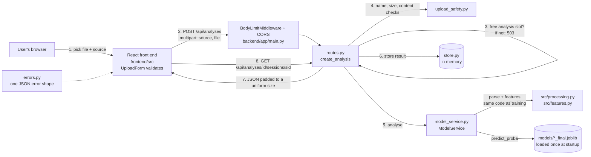

# LogSentry - Log Anomaly Detection

COS30049 Assignment 3 - Session 12, Group 3 - Shaan Panchal, Neeven Emmanuel, Dominique Tait

## 1. What LogSentry is

System logs are far too long to read line by line, and the one odd session that matters is easy to miss. LogSentry is for operators and security analysts who need to find it. You upload an HDFS or BGL log, LogSentry gives every session an anomaly score, flags the risky ones, and lets you open any session to read its original log lines.

It is a React front end talking to a FastAPI back end, which runs the model we trained in Assignment 2. For this assignment we treated that model as a black box and put our effort into the application around it, mainly into making it hard to abuse.

| Team member | Main responsibility |
|---|---|
| Dominique Tait | Back end, security defences and the side-channel attack |
| Shaan Panchal | Front end and charts |
| Neeven Emmanuel Thumma | README, documentation and testing |

## 2. Repository layout

| Folder | What it is |
|---|---|
| `frontend/` | React app (built with esbuild, served on port 5173) |
| `backend/` | FastAPI app (port 8000), its tests, the manual upload test kit and the attack scripts |
| `src/` | The A2 pipeline (parsing, features, training). The back end imports the parsing and feature code from here, so training and prediction process logs in exactly the same way. |
| `models/` | The trained models (`HDFS_final.joblib`, `BGL_final.joblib`, `*_clusters.joblib`) |
| `data/` | Prepared datasets, and sample logs in `data/supporting/` |
| `results/` | A2 evaluation results |

The models stay in `models/` and the A2 code in `src/`, rather than inside `backend/`, because the training scripts in `src/` write to `models/` and the back end must use the same feature code the model was trained with (`backend/app/a2.py`). Moving them would mean two copies of the pipeline that could drift apart. The back end finds both through `backend/app/config.py`.

## 3. Setup and run

Run every command from the repository root unless a step says otherwise. You need two terminals: one for the back end and one for the front end.

### Requirements

- Python **3.12**
- Node.js **24** (the exact version is in `frontend/.nvmrc`: 24.21.0)
- Git

### Back end (Terminal 1)

Check the Python version first with `python --version` (Windows) or `python3 --version` (Mac/Linux). It must say 3.12, because the pinned packages and the saved models were built for it. If your default Python is a different version, use `py -3.12` on Windows or `python3.12` on Mac/Linux in place of `python` or `python3` in the first command below.

Windows:
```
cd backend
python -m venv .venv
.venv\Scripts\pip install -r requirements.txt
.venv\Scripts\python -m uvicorn app.main:app --host 127.0.0.1 --port 8000
```

Mac/Linux:
```
cd backend
python3 -m venv .venv
.venv/bin/pip install -r requirements.txt
.venv/bin/python -m uvicorn app.main:app --host 127.0.0.1 --port 8000
```

Wait for `Application startup complete`. The models load at this point, once, not on every request. The API documentation is then at http://127.0.0.1:8000/docs.

### Front end (Terminal 2)

```
cd frontend
npm ci
npm start
```

Open **http://localhost:5173**, choose source **HDFS** and upload `data/supporting/sample_HDFS.log`. Within a few seconds you should see the summary (200 sessions, 40 flagged), the score histogram, the session timeline and the session table. Click any session to see its log lines.

> **Use `localhost`, not `127.0.0.1`, for the front end.** The back end's CORS setting allows only `http://localhost:5173`. If you open `http://127.0.0.1:5173`, the browser blocks every request to the API.

If something doesn't start:
- Check that the back end is still running in Terminal 1 and printed `Application startup complete`.
- Check that nothing else is using port 8000 or 5173.
- Make sure you ran `npm ci` inside `frontend/`, not in the repository root.

Stop either server with **Ctrl+C** in its terminal.

### Running the tests

Back end, Windows:
```
cd backend
.venv\Scripts\pip install -r requirements-dev.txt
.venv\Scripts\python -m pytest
```

Back end, Mac/Linux:
```
cd backend
.venv/bin/pip install -r requirements-dev.txt
.venv/bin/python -m pytest
```

Front end:
```
cd frontend
npm test
```

### Settings

All settings are optional environment variables, read in `backend/app/config.py`.

| Variable | Default | What it does |
|---|---|---|
| `LOGSENTRY_FRONTEND_ORIGIN` | `http://localhost:5173` | The only origin CORS allows |
| `LOGSENTRY_MAX_UPLOAD_BYTES` | `5242880` (5 MiB) | Largest log file accepted |
| `LOGSENTRY_MAX_CONCURRENT_ANALYSES` | `2` | How many analyses can run at once. Any more get an immediate 503. |
| `LOGSENTRY_UNIFORM_SIZE` | `1` (on) | Pads responses so their size doesn't reveal the result. Set it to `0` only to measure the attack. |

The app has no passwords, API keys or other secrets. Settings come from environment variables, not from the source code.

### Optional: rebuilding the A2 data or models

You do **not** need these steps to run the app. The prepared datasets are in `data/processed/` and the trained models are in `models/`. They use the A2 environment in the root `requirements.txt` and `environment.yml`, not the back-end environment.

```bash
conda env create -f environment.yml
conda activate logsentry
```

**Process the data.** `setup_data.py` only builds a table that is missing. If `data/processed/<SOURCE>_sessions.csv.gz` already exists, `--process-only` does nothing and downloads nothing. To rebuild a table, delete or move its `.csv.gz` file first, then run the commands below. They download the raw Loghub data from Zenodo, verify its checksum, sort the log by time and build the feature table. `eda.py` then analyses a prepared dataset.

```bash
python setup_data.py --source HDFS --process-only
python setup_data.py --source BGL --process-only
python src/eda.py --source HDFS
python src/eda.py --source BGL
```

**Raw logs (optional).** These are only used to rebuild missing datasets and to add example events to cluster descriptions and error analysis. The HDFS download is large: the sorted log is about 1.5 GB and takes about 10 minutes.

```bash
python setup_data.py --source HDFS --raw-only
python setup_data.py --source BGL --raw-only
```

**Train the models:**

```bash
python src/train.py --source HDFS
python src/train.py --source BGL
```

**Score a log from the command line:**

```bash
python src/predict.py --source HDFS --log data/supporting/sample_HDFS.log --out predictions.csv
python src/predict.py --source BGL --log data/supporting/sample_BGL.log --out predictions_bgl.csv
```

On Windows, `src/mkl_setup.py` automatically works around an MKL threading issue.

## 4. Pinned dependencies

**Back end** (`backend/requirements.txt`, Python 3.12):

| Package | Version |
|---|---|
| fastapi | 0.143.0 |
| starlette | 1.7.0 |
| pydantic | 2.14.1 |
| uvicorn | 0.46.0 |
| python-multipart | 0.0.31 |
| numpy | 2.5.3 |
| pandas | 3.0.6 |
| scikit-learn | 1.9.1 |
| scipy | 1.18.1 |
| joblib | 1.6.0 |

The tests also need `pytest` 8.4.2 and `httpx` 0.28.1 (`backend/requirements-dev.txt`). scikit-learn must stay at 1.9.1, because the saved models are pickles created with that version.

**Front end** (`frontend/package.json`, Node.js 24.21.0):

| Package | Version |
|---|---|
| react | 19.3.0 |
| react-dom | 19.3.0 |
| esbuild | 0.28.2 |

`npm ci` installs the exact versions recorded in `frontend/package-lock.json`.

The root `requirements.txt` and `environment.yml` are only for the A2 training pipeline, not for running the app.

## 5. Architecture



One request, step by step:

1. **The user picks a file and a source (HDFS or BGL).** The upload form checks the file type and size before sending anything. This is for usability only. The back end does the real checks.
2. **The front end sends `POST /api/analyses`** as multipart form data (`source`, `file`). `BodyLimitMiddleware` refuses a request that is too large before reading it, and CORS lets only our own front end read the reply (`backend/app/main.py`).
3. **`create_analysis` in `routes.py` asks for one of the analysis slots.** If every slot is busy it answers 503 straight away, instead of queueing work it cannot handle.
4. **`upload_safety.py` checks the upload.** It checks the file name, saves the file under a name the server generates, enforces the size limit while copying, and checks that the content really is a text log in the chosen format.
5. **`model_service.py` analyses the log.** It parses the log and builds session features with the same A2 code used in training (`src/processing.py`, `src/features.py`), then scores every session with the model loaded at startup. The uploaded file is then deleted.
6. **The result is stored in memory** (`store.py`) under a random ID.
7. **The back end returns JSON** with the summary and every session's anomaly score. The response is padded so its size doesn't reveal how many sessions were flagged.
8. **When the user selects a session**, the front end calls `GET /api/analyses/{id}/sessions/{session_id}` and shows that session's details and log lines.

Every error, expected or not, comes back in the same shape, `{"error": "...", "detail": "..."}` (`backend/app/errors.py`). Unexpected errors are written to the server log, and the user never sees a stack trace.

## 6. Threat model

A log analyser is an unusual target, because the people whose activity is in the logs are the very people it is meant to catch. That shaped everything below.

**Who would attack it?**
- An intruder on a monitored system who wants their activity to slip past unnoticed.
- Anyone who can reach the API directly. It is an HTTP service, so nobody has to go through our front end.

**What do they want?**
- To get their malicious session scored as normal, hidden among normal logs.
- To plant content in a log line, such as HTML or a script inside a message, and have it run in the analyst's browser.
- To knock the service over, so logs stop being checked at all.
- To find out whether their log was flagged, even without being able to read the result.

**What can they actually do?**
- Upload any file they like, with any name, size or content, using a tool such as curl. That skips the front end's checks completely.
- Send many requests at once, or one log that is deliberately expensive to process.
- Time the responses or measure how big they are.

**Which Section 2.7 risks this design has**

| Risk | Applies? | Why |
|---|---|---|
| Unsafe file upload | Yes | The whole app is built around uploading log files. |
| Denial of service | Yes | Parsing and scoring a log costs far more than sending one. |
| Missing rate limiting | Yes | Every API can be flooded. |
| Misconfiguration and vulnerable dependencies | Yes | Every app depends on libraries and default settings. |
| Unsafe model loading | Yes | The models are joblib pickles. They ship in the repository rather than being downloaded, which lowers the risk. |
| SQL injection | No | There is no database. Results are kept in memory (`backend/app/store.py`). |
| Command injection | No | The back end never runs a system command. |
| SSRF | No | The back end never makes an outbound request based on the input. |
| Broken access control | No | There are no user accounts. Analyses are reached through random UUIDs that can't be guessed. |

We defended the two "yes" risks a log-upload service is most exposed to: unsafe file upload and denial of service (Section 8). The other "yes" risks are real, and we have not built defences for them (see Section 11). For Section 2.8 we chose the response-size side channel, because "was my log flagged?" is exactly what an intruder wants to know.

## 7. How malicious input is handled

- **Log text is never rendered as HTML.** React escapes all text, and the front end never uses `dangerouslySetInnerHTML`, so a `<script>` inside a log line is shown as plain text in the session detail view (`frontend/src/SessionDetail.jsx`).
- **Upload size is limited on the back end**, both for the whole request (`BodyLimitMiddleware` in `backend/app/main.py`) and for the file while it is saved (`save_upload` in `backend/app/upload_safety.py`).
- **CORS allows only `http://localhost:5173`** (`backend/app/main.py`), never every origin.
- **No secrets are in the repository.**
- **Why 5 MiB:** the sample logs are about 0.4 MB, and a real log extract of a few thousand sessions fits under 5 MiB. Larger files would make an analysis take long enough to tie up the server. The limit can be changed with `LOGSENTRY_MAX_UPLOAD_BYTES`.

## 8. Security defences to be marked (Section 2.7)

### 8.1 Unsafe file upload (Intermediate)

**The attack:** an attacker skips our front end and uses curl to send a file with a name like `../evil.log` (to write outside the upload folder), a file far larger than any real log, or a non-log file such as an executable or image renamed to `.log`.

**How the code stops it** (`backend/app/upload_safety.py`, called from `create_analysis` in `backend/app/routes.py`):
1. **File name:** a name containing a path, `..`, a drive letter, control characters or unusual symbols is refused with 400. Only `.log` and `.txt` are accepted. The name is only checked, never used: the file is saved under a name the server generates, in a private temporary folder.
2. **Size:** the file is copied in chunks and refused with 413 as soon as it passes 5 MiB. Separately, `BodyLimitMiddleware` refuses an oversized request before reading it, even when the request lies about its size.
3. **Content:** the extension and `Content-Type` header are not trusted. The bytes are checked for known binary signatures (PNG, ZIP, PDF, executables and others), NUL and control characters, and valid UTF-8. At least 90% of lines must match the chosen source's log format.

**Proof:** `backend/manual_upload_tests/run_upload_tests.py` sends 29 test uploads to a running back end, most of them attacks, including `../evil.log`, a file one byte over the limit, PNG bytes renamed `.log`, and a log sent with the wrong source. It prints a pass/fail table. See Appendix A.

```
backend\.venv\Scripts\python backend\manual_upload_tests\run_upload_tests.py      (Windows)
backend/.venv/bin/python backend/manual_upload_tests/run_upload_tests.py          (Mac/Linux)
```

**Cost:** a genuine log with many lines in an unexpected format is refused (422) rather than analysed, and filenames with unusual characters must be renamed before upload.

### 8.2 Denial of service (Advanced)

**The attack:** analysing a log costs far more than sending it. An attacker sends many large logs at once, so the server spends all its time on them and real users wait or time out.

**How the code stops it** (`backend/app/routes.py`, `backend/app/config.py`): `create_analysis` is a plain `def` endpoint, so FastAPI runs scoring in a worker thread and it doesn't block other requests. At most `LOGSENTRY_MAX_CONCURRENT_ANALYSES` analyses (default 2) run at once. Any extra upload is refused immediately with **503** and `Retry-After: 5`, instead of queueing and holding a thread and its upload.

**Proof:** `backend/attacks/dos_demo.py` sends 12 log files of 4.84 MB at the same time, just under the upload limit, while timing ordinary GET requests. Results from 25 October 2026 on a Windows laptop with one uvicorn worker (Appendix B):

| | Responses | Flood finished in | GET median | GET max |
|---|---|---|---|---|
| Without the defence (`LOGSENTRY_MAX_CONCURRENT_ANALYSES=1000`) | 12 × 201 | 9.6 s | 150 ms | 1402 ms |
| With the defence (cap of 2) | 2 × 201, 10 × 503 | 1.6 s | 26 ms | 432 ms |

To run it, start the server with the variable set for the "without" run, then restart without it:
```
backend\.venv\Scripts\python backend\attacks\dos_demo.py --flood 12      (Windows)
backend/.venv/bin/python backend/attacks/dos_demo.py --flood 12          (Mac/Linux)
```

**Cost:** when more than two analyses are already running, real users also get a 503 and have to retry a few seconds later.

## 9. Advanced security to be marked (Section 2.8): response-size side channel

**The attack:** HTTPS hides what a response says, but not how long it is. Before our fix, the analysis response for a log with a flagged session was a few bytes different in size from one with no flagged sessions. Someone who could only see the size of the traffic could therefore tell whether a log had been flagged. `backend/attacks/size_attack.py` sends two logs 100 times each: one with only normal sessions, and one where a single normal session is swapped for a flagged one with the same number of lines. It fits a size threshold on the first half of the runs and tests it on the second half, so 50% accuracy means guessing.

**How the code stops it** (`_padded`, `_analysis_response` and `_detail_response` in `backend/app/routes.py`): JSON ignores trailing spaces, so each response is padded with spaces to a fixed size. An analysis is padded to `2048 + 256 × number of sessions` bytes, so its size reveals only the session count, which the sender already knows. A session detail is padded to the size it would have with the widest possible score and the longest cluster description. `backend/tests/test_size.py` flips the decision on the same session and checks that the size stays the same.

**Before and after** (`backend/attacks/size_results.json`):

| | Normal log | Flagged log | Attack accuracy |
|---|---|---|---|
| Before (`LOGSENTRY_UNIFORM_SIZE=0`) | 3362 bytes | 3356 bytes | 100% |
| After (default) | 7168 bytes | 7168 bytes | 50% (guessing) |

**Cost:** analysis responses are about twice as large (7168 instead of 3362 bytes here), and session details carry up to about 2 KB of padding. Compression (gzip) must stay off, because compressed sizes would differ again.

**Why not a timing side channel:** we tried that first. The back end runs the cluster model only for flagged sessions, but that costs about 0.35 ms, while normal network jitter was 14 to 32 ms. Across 5 runs of 200 requests per outcome the attack's accuracy ranged from 49% to 77%, so we could not show a reliable leak. The response size leaked on every request, so that is the one we defended and measured.

## 10. API documentation

The full, interactive API documentation is at http://127.0.0.1:8000/docs while the back end is running. Every endpoint has a description and example requests and responses, including the error responses.

| Method and path | What it does |
|---|---|
| `POST /api/analyses` | Upload a log (`source` + `file`). Returns the summary and every scored session. |
| `GET /api/analyses/{id}` | Get a stored analysis again. |
| `GET /api/analyses/{id}/sessions/{session_id}` | Get one session in detail, including its log lines. |
| `DELETE /api/analyses/{id}` | Delete a stored analysis. |

## 11. Known limitations and next steps

- Results are kept in memory only. They are lost when the server restarts, and there is no limit yet on how many analyses are kept, so memory grows until a restart.
- There are no user accounts, so anyone who has an analysis ID can read or delete that analysis.
- Only HDFS and BGL logs are supported.
- When the server is busy, the concurrency cap also turns real users away with a 503. They have to wait a few seconds and retry.
- Python's multipart parser removes Windows-style paths such as `C:\Windows\evil.log` before our code sees them, so these names arrive as `evil.log` and are accepted. This is harmless, because the name is never used as a path. Details are in Appendix A.
- We have no defence of our own against request-rate abuse, vulnerable dependencies or a tampered model file. The concurrency cap limits how much work runs at once, but it does not limit how often one client can send requests. The models are not checked against a hash when the server starts.

Next, we would:
- add a database for saved results, with a limit on how long they are kept;
- add user accounts so each analysis belongs to its owner;
- add rate limiting per client;
- check the model files against a known hash at startup;
- scan dependencies with `pip-audit` and `npm audit` as part of every build.

## 12. References

Bortz, A. and Boneh, D. (2007) 'Exposing private information by timing web applications', in *Proceedings of the 16th International Conference on World Wide Web*. ACM, pp. 621–628. Available at: https://crypto.stanford.edu/~dabo/abstracts/webtiming.html (Accessed: 28 October 2026).

Chen, S., Wang, R., Wang, X. and Zhang, K. (2010) 'Side-channel leaks in web applications: a reality today, a challenge tomorrow', in *2010 IEEE Symposium on Security and Privacy*. IEEE, pp. 191–206. Available at: https://www.microsoft.com/en-us/research/?p=158925 (Accessed: 28 October 2026).

FastAPI (n.d.) *FastAPI documentation*. Available at: https://fastapi.tiangolo.com/ (Accessed: 28 October 2026).

LOGPAI (2023) *Loghub: a large collection of system log datasets for AI-driven log analytics* [Dataset]. Zenodo. Available at: https://doi.org/10.5281/zenodo.8196385 (Accessed: 28 October 2026).

Meta Platforms (n.d.) *React documentation*. Available at: https://react.dev/ (Accessed: 28 October 2026).

OWASP Foundation (2021) *OWASP Top 10: 2021*. Available at: https://owasp.org/www-project-top-ten/ (Accessed: 28 October 2026).

Pedregosa, F., Varoquaux, G., Gramfort, A., Michel, V., Thirion, B., Grisel, O., Blondel, M., Prettenhofer, P., Weiss, R., Dubourg, V., Vanderplas, J., Passos, A., Cournapeau, D., Brucher, M., Perrot, M. and Duchesnay, É. (2011) 'Scikit-learn: machine learning in Python', *Journal of Machine Learning Research*, 12, pp. 2825–2830.

## 13. Generative AI statement

[DRAFT: each person must check and finish their own paragraph before submission. Delete this line when done.]

We used generative AI tools during this assignment. Every member read, ran and tested the work they submitted, and each of us can explain the parts we present in the video.

**Neeven Emmanuel Thumma:** I used Claude to review the code on our A3 branches against the brief and rubric, to draft this README, and to check its facts (commands, versions, file names and settings) against the repository. I reviewed every section against the code. [Add once done: I followed the setup steps on a fresh clone on my own Mac to confirm they work.] [Add any other AI tool you used.]

**Dominique Tait:** [Dominique to write: which tools, what for, how the output was checked.]

**Shaan Panchal:** [Shaan to write: which tools, what for, how the output was checked.]

## Appendix A. Manual upload-security test kit

Files in `backend/manual_upload_tests/`. Relative paths below are inside that folder.

A repeatable way to check the unsafe-file-upload defence by hand, against a **running** LogSentry backend. The defence
is in `backend/app/upload_safety.py`, and the request-size limit is in `BodyLimitMiddleware` in `backend/app/main.py`.

This is a **local test utility, not production application code**. Nothing in `backend/app/` imports it. The pytest
suite does not collect it: `backend/pytest.ini` only looks in `tests/`. It never starts, stops or reconfigures the server. It only writes inside its own temporary folder
(`logsentry-manual-upload-*` in the system temp folder), which is deleted when the run ends.

### Contents

| Path | What it is |
|---|---|
| `run_upload_tests.py` | The runner. It sends each case to `POST /api/analyses` over a plain socket and prints a PASS/FAIL table. It uses only the Python standard library. |
| `fixtures/valid_hdfs.log` | First 120 lines of `data/supporting/sample_HDFS.log` (17 KB). Accepted, 12 sessions. |
| `fixtures/valid_bgl.log` | First 120 lines of `data/supporting/sample_BGL.log` (19 KB). Accepted, 5 sessions. |
| `fixtures/empty.log` | 0 bytes. |
| `fixtures/wrong_extension.exe` | Two lines of harmless plain text, named `.exe`. |
| `fixtures/png_renamed.log` | A PNG signature and IHDR header followed by harmless bytes. It is not a real image. |
| `fixtures/hdfs_content_for_bgl_source.log` | Lines 121 to 150 of the HDFS sample. The runner sends it with `source=BGL`. |
| `fixtures/bgl_content_for_hdfs_source.log` | Lines 121 to 150 of the BGL sample. The runner sends it with `source=HDFS`. |
| `fixtures/malformed_lines.log` | 5 real HDFS lines followed by 25 lines of plain text in no log format. Only 17% of lines are valid, and 90% are needed. |
| `fixtures/.gitattributes` | Stops git from converting line endings in the fixtures. |

The oversized files are **not stored** in the repository. The runner generates them in its temporary folder at run
time and deletes them afterwards. They are the valid fixture's harmless log lines, repeated:

- `oversized_file.log` is `MAX_UPLOAD_BYTES + 1` bytes (5,242,881).
- `oversized_request.log` is 1 MiB more than the whole-request limit.

All fixtures are small extracts of the sample logs already in the repository. None of them is a raw dataset or private data.

### Prerequisites

- The backend virtual environment with `backend/requirements.txt` installed: `backend\.venv`. The kit needs no extra packages.
- A running backend. In a separate terminal, from the repository root:

  ```powershell
  cd backend
  .venv\Scripts\python -m uvicorn app.main:app --host 127.0.0.1 --port 8000
  ```

  Wait until uvicorn prints `Application startup complete` (the models load at startup).

### Running it

From the repository root:

```powershell
backend\.venv\Scripts\python backend\manual_upload_tests\run_upload_tests.py
```

Options:

| Option | Meaning |
|---|---|
| `--base-url URL` | The server to test. The default is `http://127.0.0.1:8000`, the address `frontend/src/config.js` uses. |
| `--source HDFS\|BGL` | The source used for the filename, size, malformed-lines and recovery cases. The default is HDFS. The two valid-log and two wrong-source cases always use their own fixed source. |
| `--max-upload-bytes N` | Only needed if the server was started with a non-default `LOGSENTRY_MAX_UPLOAD_BYTES`. By default the limits are read from `backend/app/config.py`. |
| `--timeout S` | How many seconds to wait for each reply. The default is 60. |
| `--verbose` | Also show the server's `error`/`detail` (or `analysis_id`) for passing cases. |
| `--keep-analyses` | Keep the analyses this run created. By default they are removed with `DELETE /api/analyses/{id}` at the end. |
| `--dry-run` | List the cases and show how the multipart parser treats each filename, without sending anything. |

### Reading the output

Each row shows the test, the expected and actual HTTP status, and the result:

- **PASS**: the status matched. For a refusal, the body also had exactly `{"error": "...", "detail": "..."}`, the
  `error` code matched the status (`bad_request`, `payload_too_large`, `unsupported_media_type` or `invalid_input`),
  and the `detail` gave the expected reason, so the file was refused for the right reason. For an acceptance, the
  body held an `analysis_id`.
- **FAIL**: the server answered, but not as expected. The line below the row shows what it said instead.
- **ERROR**: no reply could be obtained, for example because the connection was refused or reset, or timed out. This is never
  counted as a pass.

Before any case runs, the runner checks that `GET /openapi.json` lists `/api/analyses`. If the server is down, or
something else is on that port, it prints `SERVER UNAVAILABLE`, runs nothing and exits with code 2.

After the table it prints:

- the outcome of the Windows drive and UNC filename cases, and the name each one arrives as at the application;
- a read-only look at the server's private upload folders (`logsentry-uploads-*` in the temp folder). They should
  contain 0 files. Nothing there is ever deleted by the runner. This check is informational and does not change the
  exit code;
- how many of the analyses it created were deleted.

**Exit codes:**

| Code | Meaning |
|---|---|
| 0 | Every case passed. |
| 1 | At least one case failed: a genuine difference from the expected behaviour. |
| 2 | The server could not be reached, or at least one case ended in a network error. The defence was not fully verified. |

If a run has both failures and network errors, the exit code is 1.

### Expected outcomes

These were all observed against a local server on 2026-10-13: 30 of 30 passed with `--source HDFS`, and again with
`--source BGL`.

| # | Case | Expected | Why |
|---|---|---|---|
| 1 | valid HDFS log, source HDFS | 201 | Passes every check and is scored. |
| 2 | valid BGL log, source BGL | 201 | Same. |
| 3 | empty file | 422 | `The file is empty.` |
| 4 | text file named `.exe` | 415 | `Upload a .log or .txt file.` The extension is checked first. |
| 5 | PNG bytes renamed `.log` | 415 | `This is a PNG file, not a text log.` The extension and Content-Type are not trusted. |
| 6 | HDFS log sent with source BGL | 422 | `This does not look like a BGL log: only 0 of 30 lines ...` |
| 7 | BGL log sent with source HDFS | 422 | `This does not look like a HDFS log: only 0 of 30 lines ...` |
| 8 | mostly malformed lines | 422 | Only 5 of 30 lines are in the format (90% needed). |
| 9 | file of limit + 1 bytes | 413 | `The file is larger than 5 MiB.` The whole request is under the request limit, so the file is caught while it is copied. |
| 10 | request over the request limit | 413 | `Request body is too large.` The middleware refuses it on the declared Content-Length, before reading the body. |
| 11 | `../evil.log` | 400 | `The file name must be a plain file name, not a path.` |
| 12, 13 | `..\evil.log` (escaped, raw) | 400 | Same. |
| 14 | `../../outside.log` | 400 | Same. |
| 15 | `subfolder/evil.log` | 400 | Same. |
| 16, 17 | `subfolder\evil.log` (escaped, raw) | 400 | Same. |
| 18 | `C:evil.log` | 400 | Same (drive prefix). |
| 19 | `C:/Windows/evil.log` | 400 | Same. |
| 20 | `//server/share/evil.log` | 400 | Same (UNC prefix with forward slashes). |
| 21, 22 | `C:\Windows\evil.log` (escaped, raw) | **201** | Known limitation, see below. It arrives as `evil.log`. |
| 23 | `\\server\share\evil.log` (escaped) | **201** | Known limitation, see below. It arrives as `evil.log`. |
| 24 | `\\server\share\evil.log` (raw) | 400 | It arrives as `\server\share\evil.log` and is refused as a path. |
| 25 | `sample;whoami\|more&$(id).log` | 400 | `Use only letters, digits, spaces and ...` The name is never executed or used as a path, but it is refused anyway. |
| 26 | `sample<ESC>[31m.log` | 400 | `The file name contains control characters.` |
| 27 | `sample<NUL>.log` | 400 | Same. |
| 28 | `sample_HDFS (1).log` (or `sample_BGL (1).log`) | 201 | An ordinary name with a space and brackets is accepted. |
| 29 | valid upload after all the rejections | 201 | The application is still usable. |
| 30 | `GET` of that analysis | 200 | The stored result can be read back. |

**Escaped and raw filenames.** The runner writes each filename byte-for-byte into the multipart
`Content-Disposition` header. It does not use an HTTP client library, which could rewrite the name. Only for names that contain a
backslash, it sends two encodings, because python-multipart treats them differently:

- *escaped*: each `\` is written as `\\`. httpx (used by the pytest `TestClient`) and urllib3/requests do this.
- *raw*: `\` is written as it is. Browsers do this (WHATWG multipart/form-data encoding).

The control characters in cases 26 and 27 are also sent unchanged as raw bytes. A probe that recorded the name the
application received confirmed that they arrive intact, so the control-character rule is what refuses them.

### Known limitation: Windows drive and UNC names with backslashes

On Windows these names cannot be created as files, so the kit does not try. Instead it uploads `valid_hdfs.log` (or
`valid_bgl.log`) and sets only the multipart filename to the exact string.

python-multipart 0.0.31 (`python_multipart/multipart.py`, `parse_options_header`) changes the filename **before
FastAPI or LogSentry see it**:

1. It un-escapes the quoted value: `\\` becomes `\`.
2. Then it applies an old Internet Explorer 6 workaround. If the value starts with `X:\` or `\\`, it keeps only the
   text after the last backslash.

Observed results:

| Multipart filename sent | Encoding | Arrives at the app as | HTTP status |
|---|---|---|---|
| `C:\Windows\evil.log` | escaped | `evil.log` | **201, accepted** |
| `C:\Windows\evil.log` | raw | `evil.log` | **201, accepted** |
| `\\server\share\evil.log` | escaped | `evil.log` | **201, accepted** |
| `\\server\share\evil.log` | raw | `\server\share\evil.log` | 400, refused |

So the application **does not reject** `C:\Windows\evil.log` in either encoding, or the escaped
`\\server\share\evil.log`. It never receives the path text, so `check_filename` cannot see it. When
`check_filename` is called directly, it refuses both forms with 400 (`test_filename_check_unit_cases`).

The accepted uploads are still harmless:

- The path part was removed before the application ran.
- The uploaded file is never stored under the client's name. `save_upload` writes it to a server-generated
  `upload-*.log` in the private temporary folder and deletes it after scoring.
- No path is ever built from the filename.

The automated test `test_backslash_drive_and_unc_paths_are_cut_to_a_plain_name_by_the_multipart_parser` pins the
escaped behaviour. The runner's "arrives as" column is computed locally with the python-multipart installed in the
interpreter running the kit. Run the kit with `backend\.venv\Scripts\python` so it matches the server's version.

### What is covered where

| Behaviour | Live API (this kit) | Automated only (`backend/tests/`) |
|---|---|---|
| Valid HDFS/BGL uploads, empty file, wrong extension, PNG renamed `.log`, wrong source, malformed lines | yes | also covered |
| File one byte over the limit; request over the limit, refused on Content-Length | yes | also covered |
| Chunked body without Content-Length; understated Content-Length; invalid Content-Length | no | `test_upload_defence.py`, `test_upload_live.py` |
| File of exactly the limit is not refused for size | no | `test_file_at_the_limit_is_not_refused_for_size` |
| Path, drive, UNC, shell-character and control-character filenames | yes | also covered |
| Which name the server actually received (proof the crafted name arrived) | parser view only (computed locally) | `received_names` fixture in `test_upload_defence.py` |
| Refused uploads never reach the model | no | `pipeline_calls` fixture |
| Temporary file deleted after a refusal or a **model failure** | read-only folder check only | `nothing_left_behind` (autouse) and `test_temporary_file_is_removed_when_the_model_fails` |
| Upload stored under a generated name in the private folder | no | `test_upload_is_stored_under_a_generated_name_in_the_private_folder` |
| Upload folder recreated if a temp cleaner removed it | no | `test_upload_folder_is_recreated_if_a_temp_cleaner_deleted_it` |
| Binary variants (gzip, zip, PDF, ELF, EXE, JPEG, UTF-16), NUL in the text, Latin-1 bytes, BOM and CRLF | no | `test_upload_defence.py` |

#### Model failure and cleanup

Do not crash or corrupt a running server to test this. The automated test does it safely, in an isolated in-process
`TestClient`:

- It replaces the model's `analyse` with a function that raises.
- It checks that the client gets the generic 500 `{"error": "internal_error", ...}`.
- The autouse `nothing_left_behind` fixture then checks that the private upload folder is empty.

From the repository root:

```powershell
backend\.venv\Scripts\python -m pytest backend/tests/test_upload_defence.py -k "model_fails or generated_name or temp_cleaner" -v
```

Every test in `test_upload_defence.py` also runs the empty-folder check. To run the whole upload defence, including
the real-socket size tests:

```powershell
backend\.venv\Scripts\python -m pytest backend/tests/test_upload_defence.py backend/tests/test_upload_live.py -v
```

## Appendix B. Attack scripts (local test utilities, not application code)

Files in `backend/attacks/`. Relative paths below are inside that folder.

Run from the repository root against a backend you started yourself. Attack only your own machine. Standard library only.

| Script | Defence it tests | Code under test |
|---|---|---|
| `dos_demo.py` | Denial of service (§2.7, Advanced) | `_analysis_slots` in `backend/app/routes.py`, `MAX_CONCURRENT_ANALYSES` in `config.py` |
| `size_attack.py` | **Response-size side channel (§2.8, the one to be marked)** | `_padded`, `_analysis_response`, `_detail_response` in `backend/app/routes.py`, `UNIFORM_SIZE` in `config.py` |

Each script's docstring explains how to switch its defence off for the "before" run.

### Results (25 Oct 2026, Windows laptop, one uvicorn worker)

**Denial of service**: one 4.84 MB HDFS log (just under the 5 MiB upload cap) takes about 1 s to analyse. 12 of them were sent at once while GET requests were timed:

| | Statuses | Flood finished | GET median | GET max |
|---|---|---|---|---|
| Without the defence (`LOGSENTRY_MAX_CONCURRENT_ANALYSES=1000`) | 12 × 201 | 9.6 s | 150 ms | 1402 ms |
| With the defence (cap 2) | 2 × 201, 10 × 503 (median 113 ms) | 1.6 s | 26 ms | 432 ms |

Cost: when more than 2 analyses are running, legitimate users also get a 503 and have to retry (`Retry-After: 5`).

**Response-size side channel**: 100 uploads per outcome of two logs with 20 sessions each. The threshold is fitted on the first half of the runs and tested on the second half, so 50% means guessing. Raw numbers are in `size_results.json`.

| | Normal log | Flagged log | Attack accuracy |
|---|---|---|---|
| Before (`LOGSENTRY_UNIFORM_SIZE=0`) | 3362 bytes | 3356 bytes | 100% |
| After (default) | 7168 bytes | 7168 bytes | 50% |

How it works: an analysis is padded with trailing spaces to `2048 + 256 × sessions` bytes, so its size reveals only the session count, which the sender already knows. A session detail is padded to the size it would have with the widest score and the longest cluster description (about 2 KB of the 1–2 KB difference). `backend/tests/test_size.py` flips the decision on the same session and checks that the size stays the same.
Cost: analysis responses are about twice as large (7168 vs 3362 bytes here), and session details carry up to about 2 KB of padding. Gzip must stay off, because compression would reintroduce a size difference.

**Why not timing:** we tried the timing side channel first. The back end runs the cluster model only when a session is flagged, which costs about 0.35 ms. Over HTTP, with 200 requests per outcome, attack accuracy was inconsistent (49% to 77% across 5 runs), because request jitter (about 14 to 32 ms) is far larger than the leak. We could not show a reliable leak, so we chose the response size, which leaks on every request.
